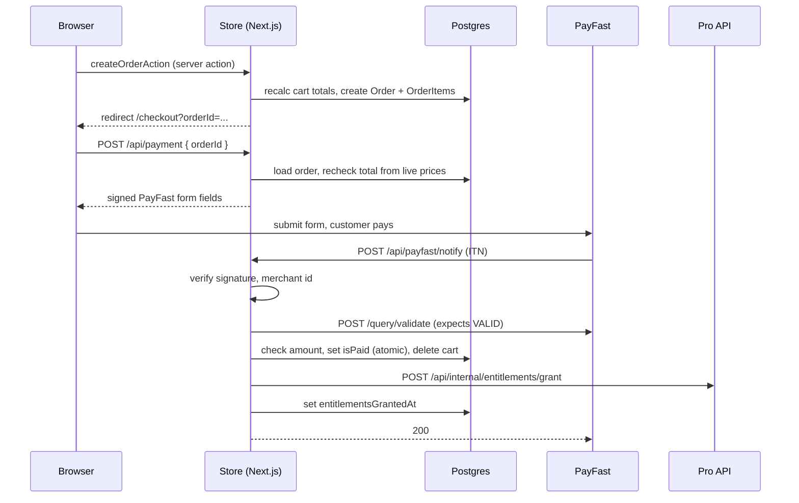

# Payment flow (PayFast)

Sources: `utils/actions/cart.ts`, `utils/actions/orders.ts`, `app/api/payment/route.ts`, `app/api/payfast/notify/route.ts`, `middleware.ts`.
Not reviewed: the `/checkout` page. The Pro grant endpoint lives in the Pro repo (see section 4).

## Sequence



## 1. Order creation: `createOrderAction` (`utils/actions/orders.ts`)

1. Requires a logged-in user (`getAuthUser`).
2. `updateCart()` recalculates (via `calculateCartTotals` in `utils/pricing.ts`) totals from current database prices (`utils/actions/cart.ts`). Stored cart totals are never trusted.
3. One `$transaction`: delete this user's unpaid orders older than 7 days, then create the `Order` with its `OrderItems`.
4. Redirects to `/checkout?orderId=...&cartId=...`.

Amounts are stored as whole Rand integers, not cents.

## 2. Checkout initiation: `POST /api/payment`

| Check                                                                                                                                                | Result on failure       |
| ---------------------------------------------------------------------------------------------------------------------------------------------------- | ----------------------- |
| PayFast credentials and `NEXTAUTH_URL` valid (https required in live mode)                                                                           | 500                     |
| Logged-in session                                                                                                                                    | 401                     |
| Order exists and belongs to the user                                                                                                                 | 404 (same as not found) |
| Order not already paid                                                                                                                               | 409                     |
| Cart exists for the order's owner                                                                                                                    | 404                     |
| Valid quantities, subtotal at least 1, and `order.orderTotal` equals subtotal + `round(taxRate * subtotal)` + shipping, using current product prices | 409                     |

On success it returns `{ actionUrl, fields }`. Fields are signed with MD5 in PayFast's fixed field order (`SIGNATURE_FIELD_ORDER`) using PHP-`urlencode`-style encoding. The passphrase is appended when set. `notify_url` is the only route allowed to mark an order paid; `return_url` (`/orders`) and `cancel_url` (`/cart`) are browser-only.

The pricing rule exists in two places: `calculateCartTotals` (used by `updateCart`) and the inline calculation in this route. They must stay in sync. A mismatch blocks checkout with a 409.

## 3. Payment notification (ITN): `POST /api/payfast/notify`

This route is public in `middleware.ts`. Its authenticity comes from the checks below, in order:

1. **Signature**: rebuilt from the fields in the order received, blank values included. Mismatch gives 400.
2. **Merchant ID** equals `PAYFAST_MERCHANT_ID`. Otherwise 400.
3. **Server validation**: the raw body is POSTed to PayFast's `/query/validate`, which must answer `VALID`. Otherwise 400.
4. **Status** must be `COMPLETE`. Other statuses get 200 and no action.
5. **Order lookup**: not found gives 404. An order already paid with `entitlementsGrantedAt` set gets 200 and no action (idempotent).
6. **Amount**: `amount_gross` must equal `order.orderTotal.toFixed(2)`. Otherwise 400.
7. **Mark paid**: `updateMany({ id, isPaid: false })` is atomic, so only one concurrent notification proceeds. The first one also deletes the owner's cart (best effort).
8. **Entitlement delivery** to Pro (below). Failure returns 500 so PayFast retries.
9. **Record delivery**: `updateMany({ id, entitlementsGrantedAt: null })` sets `entitlementsGrantedAt`.

Logging uses `logItn` with the order id and an event name only. No bodies, signatures or customer fields are logged.

### Retry behaviour

A paid order with no `entitlementsGrantedAt` skips step 7 on the next notification and retries delivery. If the Pro URL, order email or order items are missing, the route logs `bridge_skipped` and returns 200 without delivering. Those orders stay paid but undelivered, so check for them with:

```sql
select id, "updatedAt" from "Order"
where "isPaid" = true and "entitlementsGrantedAt" is null
  and "updatedAt" < now() - interval '15 minutes';
```

## 4. Store to Pro bridge

Request (from `notify/route.ts`): `POST {PRO_API_BASE_URL}/api/internal/entitlements/grant`

- Headers: `Authorization: Bearer <STORE_BRIDGE_SECRET>`, `Idempotency-Key: <order.id>`
- Body: `{ email, storeProductIds: string[] }`
- Timeout: 10 s. Any non-2xx or error gives 500 to PayFast.

**Lives in the Pro repo:** the endpoint is implemented in Sporty Pulse Pro, not in this repository. Its response format, email matching and idempotency handling are documented there, not here. If it is ever unreachable, Store logs `bridge_rejected` or `bridge_call_failed`, returns 500 and PayFast retries.

## Alert events

`bridge_rejected`, `bridge_call_failed`, `amount_mismatch`, `signature_mismatch`, `merchant_mismatch`, `source_validation_failed`, `order_not_found`, `processing_error`.

## Known gaps (not changed)

- The comment in `payment/route.ts` points to `utils/action.ts` for `updateCart()`; it now lives in `utils/actions/cart.ts`.
- Unpaid-order cleanup runs only when that customer places a new order.
- `/checkout` page behaviour is **not verified**.
